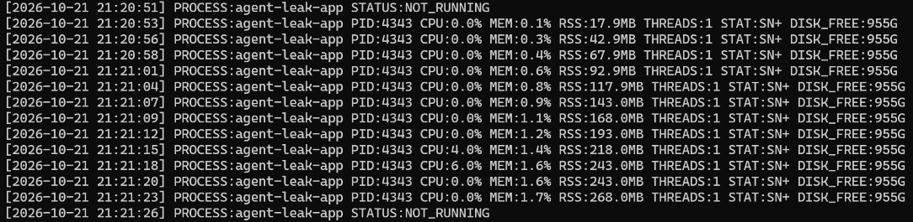
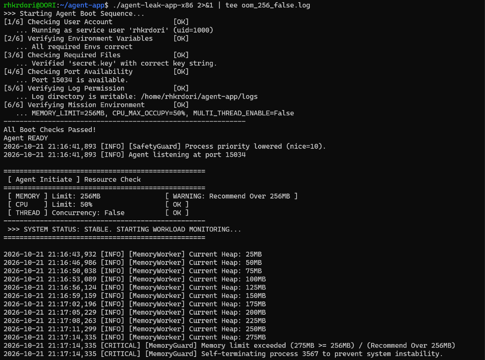
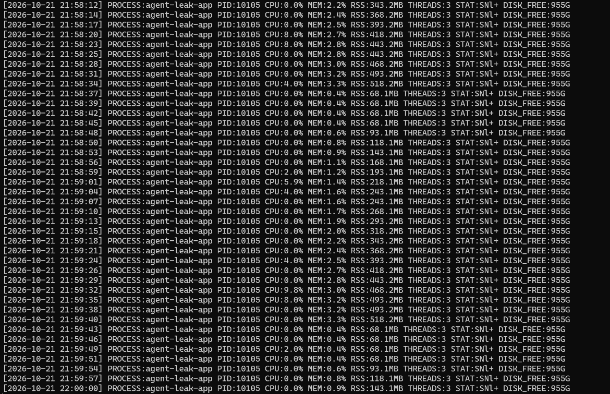
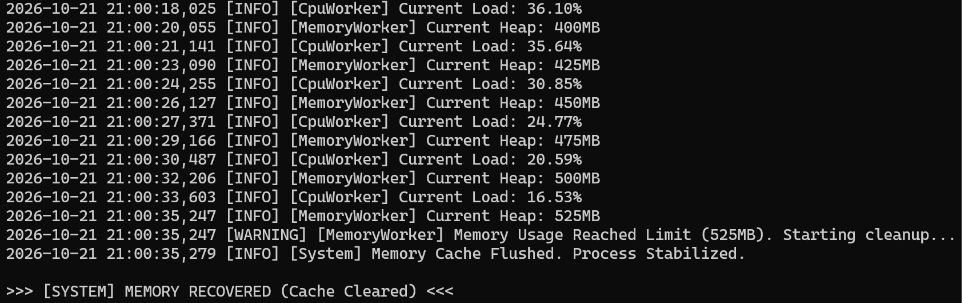

# [Bug] OOM - 메모리 누수로 약 30초 만에 MemoryGuard 정책에 의해 강제 종료

## 1. Description (현상 설명)

- `agent-leak-app`을 `MEMORY_LIMIT=256`으로 실행하면 약 30초 뒤 프로세스가 예고 없이 종료된다.
- 종료 직전 실행 로그에 `[CRITICAL] [MemoryGuard] Memory limit exceeded`와 `Self-terminating process <PID>`가 출력된다.
- 같은 조건으로 4회 실행(수동 3회 + 자동 1회)해 4회 모두 같은 지점(Heap 275MB, RSS 약 268~270MB)에서 종료되는 것을 확인했다.

**실행 환경**

| 항목 | 값 |
|---|---|
| OS | Windows + WSL2 Ubuntu (x86 바이너리 `agent-leak-app-x86`) |
| 실행 계정 | `rhkrdori` (uid=1000, root 아님) |
| 전체 메모리 | 15,633.6 MiB (Swap 4,096 MiB) |
| 조건 (Before) | `MEMORY_LIMIT=256`, `CPU_MAX_OCCUPY=50`, `MULTI_THREAD_ENABLE=false` |

부트 단계에서 이미 경고가 출력된다.

```
 [ MEMORY ] Limit: 256MB                [ WARNING: Recommend Over 256MB ]
```

## 2. Evidence & Logs (증거 자료)

### 2-1. monitor.sh 관제 로그 (Before, PID 4343)

```
[2026-10-21 21:20:51] PROCESS:agent-leak-app STATUS:NOT_RUNNING
[2026-10-21 21:20:53] PROCESS:agent-leak-app PID:4343 CPU:0.0% MEM:0.1% RSS:17.9MB THREADS:1 STAT:SN+ DISK_FREE:955G
[2026-10-21 21:20:56] PROCESS:agent-leak-app PID:4343 CPU:0.0% MEM:0.3% RSS:42.9MB THREADS:1 STAT:SN+ DISK_FREE:955G
[2026-10-21 21:21:01] PROCESS:agent-leak-app PID:4343 CPU:0.0% MEM:0.6% RSS:92.9MB THREADS:1 STAT:SN+ DISK_FREE:955G
[2026-10-21 21:21:07] PROCESS:agent-leak-app PID:4343 CPU:0.0% MEM:0.9% RSS:143.0MB THREADS:1 STAT:SN+ DISK_FREE:955G
[2026-10-21 21:21:12] PROCESS:agent-leak-app PID:4343 CPU:0.0% MEM:1.2% RSS:193.0MB THREADS:1 STAT:SN+ DISK_FREE:955G
[2026-10-21 21:21:18] PROCESS:agent-leak-app PID:4343 CPU:6.0% MEM:1.6% RSS:243.0MB THREADS:1 STAT:SN+ DISK_FREE:955G
[2026-10-21 21:21:23] PROCESS:agent-leak-app PID:4343 CPU:0.0% MEM:1.7% RSS:268.0MB THREADS:1 STAT:SN+ DISK_FREE:955G
[2026-10-21 21:21:26] PROCESS:agent-leak-app STATUS:NOT_RUNNING
```



- RSS가 17.9MB → 268.0MB로 **약 3초마다 25MB씩, 감소 구간 없이** 증가
- 같은 구간 CPU는 0~6%로 낮게 유지 → 작업량 증가가 아니라 메모리만 쌓이는 패턴
- 21:21:23까지 존재하던 PID 4343이 21:21:26에 사라짐

### 2-2. 프로그램 실행 로그 (Before, PID 3567)

```
2026-10-21 21:16:41,893 [INFO] Agent listening at port 15034
2026-10-21 21:16:43,932 [INFO] [MemoryWorker] Current Heap: 25MB
2026-10-21 21:16:46,986 [INFO] [MemoryWorker] Current Heap: 50MB
...
2026-10-21 21:17:11,299 [INFO] [MemoryWorker] Current Heap: 250MB
2026-10-21 21:17:14,335 [INFO] [MemoryWorker] Current Heap: 275MB
2026-10-21 21:17:14,335 [CRITICAL] [MemoryGuard] Memory limit exceeded (275MB >= 256MB) / (Recommend Over 256MB)
2026-10-21 21:17:14,335 [CRITICAL] [MemoryGuard] Self-terminating process 3567 to prevent system instability.
```



### 2-3. 종료 코드와 프로세스 구조 (10/23 자동 재현, PID 642)

`run_case.sh`로 같은 조건을 다시 실행하면서 OS 측 종료 코드와 `ps` 스냅샷을 기록했다. ([logs/oom_before](../logs/oom_before))

```
===== 2026-10-23 17:15:46 (+32s)   ← 종료 1초 전 ps
    PID    PPID STAT %CPU %MEM    RSS NLWP  ELAPSED CMD
    640     618 S+    0.3  0.0   2316    1    00:31 .../agent-leak-app-x86
    642     640 SN+   1.4  1.7 274408    1    00:31 .../agent-leak-app-x86

2026-10-23 17:15:47,579 [CRITICAL] [MemoryGuard] Memory limit exceeded (275MB >= 256MB) / (Recommend Over 256MB)
2026-10-23 17:15:47,579 [CRITICAL] [MemoryGuard] Self-terminating process 642 to prevent system instability.

EXIT_CODE=137 (SIGKILL)
```

- 640은 실행 파일 래퍼(부모), 642가 실제 앱(자식). 로그의 `process 642`와 ps의 PID가 일치한다.
- 종료 코드 137 = 128 + 9 → **SIGKILL**로 종료되었다.

### 2-4. 재현 결과 (Before 4회)

| 실행 | PID | 최종 RSS / Heap | 생존 시간 |
|---|---|---|---|
| 10/21 21:16 | 3567 | Heap 275MB | 21:16:41.893 → 21:17:14.335, **약 32초** |
| 10/21 21:20 | 4343 | RSS 268.0MB | monitor 기준 21:20:53 → 21:21:23 (약 30초) |
| 10/21 21:25 | 5256 | RSS 268.2MB | monitor 기준 21:25:50 → 21:26:18 (약 28초) |
| 10/23 17:15 (자동) | 642 | Heap 275MB, RSS 270MB | 17:15:15.015 → 17:15:47.579, **약 33초**, exit 137 |

## 3. Root Cause Analysis (원인 분석)

**현상 분석: 힙 메모리 누수**

- 앱 로그의 Heap 값과 OS가 측정한 RSS가 같은 속도(3초당 25MB)로 증가한다. RSS는 Heap보다 약 18MB 크며, 이는 시작 직후 RSS(약 18MB)와 같아 프로세스 기본 사용량으로 보인다.
- 정상적인 프로그램은 메모리를 할당하고 해제하기를 반복해 일정 수준에서 오르내린다. 이 앱은 해제 구간 없이 계속 증가하고, 그 동안 CPU 사용량은 변하지 않았다.
- 따라서 내부 로직이 처리한 데이터를 힙에서 해제하지 않고 계속 쌓는 **메모리 누수**로 판단했다. 소스 코드를 볼 수 없으므로 이는 관측 패턴에 근거한 추론이다.

**시스템 동작: MemoryGuard 정책에 의한 자체 종료**

- 사용량이 `MEMORY_LIMIT`(256MB)를 넘는 첫 측정(275MB)에서 MemoryGuard가 자기 프로세스를 종료했다. 로그가 `Self-terminating`이라고 명시하므로, 커널이 아닌 **애플리케이션 내부 정책**에 의한 종료다.
- 종료 코드 137(SIGKILL)은 정리 작업 없이 즉시 끝나는 시그널이다. 앱 로그뿐 아니라 OS 측에서도 강제 종료가 확인된다.
- 관련 OS 동작: 누수가 방치되면 물리 메모리가 고갈되고 swap 사용으로 시스템 전체가 느려진다. 그래도 부족하면 커널의 **OOM Killer**가 점수(`oom_score`)가 높은 프로세스를 SIGKILL로 종료하는데, 원인이 아닌 다른 프로세스가 희생될 수 있다. MemoryGuard는 그 전에 원인 프로세스가 스스로 내려와 피해를 해당 프로세스로 한정하고 종료 원인을 로그로 남기는 역할을 한다.

## 4. Workaround & Verification (조치 및 검증)

**조치**: `env.sh`의 `MEMORY_LIMIT`을 256 → 512로 변경 (다른 값은 동일)

```bash
export MEMORY_LIMIT=512   # 256 -> 512
source ~/agent-app/env.sh
```

부트 단계 경고가 사라졌다.

```
 [ MEMORY ] Limit: 512MB                [ OK ]
```

**After: monitor.sh 관제 로그 (PID 5685)**

```
[2026-10-21 21:27:32] PROCESS:agent-leak-app PID:5685 ... RSS:18.1MB ...
[2026-10-21 21:28:02] PROCESS:agent-leak-app PID:5685 ... RSS:268.3MB ...   <- Before에서 종료되던 지점 통과
[2026-10-21 21:28:33] PROCESS:agent-leak-app PID:5685 ... RSS:518.4MB ...
[2026-10-21 21:28:35] PROCESS:agent-leak-app PID:5685 ... RSS:18.3MB ...    <- 캐시 정리 후 감소
[2026-10-21 21:29:14] PROCESS:agent-leak-app PID:5685 ... RSS:318.3MB ...   <- 다시 증가, 같은 PID로 생존
```

같은 패턴(518MB → 68MB → 재증가, 같은 PID 유지)이 `MEMORY_LIMIT=512`로 실행한 21:58 실행(PID 10105)에서도 반복되었다.



**After: 프로그램 실행 로그** (`logs/agent_app.log`, 같은 조건의 20:59 실행)

```
2026-10-21 21:00:35,247 [INFO] [MemoryWorker] Current Heap: 525MB
2026-10-21 21:00:35,247 [WARNING] [MemoryWorker] Memory Usage Reached Limit (525MB). Starting cleanup...
2026-10-21 21:00:35,279 [INFO] [System] Memory Cache Flushed. Process Stabilized.
>>> [SYSTEM] MEMORY RECOVERED (Cache Cleared) <<<
```



**Before & After 비교**

| 항목 | Before (256MB) | After (512MB) |
|---|---|---|
| 메모리 증가 속도 | 3초당 25MB | 3초당 25MB (변화 없음) |
| 최대 RSS | 약 268~270MB | 518.4MB |
| 결과 | MemoryGuard 자체 종료 (exit 137, SIGKILL) | 한도 도달 시 캐시 정리 후 계속 실행 |
| 생존 시간 | 약 28~33초 (4회) | 수동: 1분 42초 이상 / 자동: 120초 관찰 동안 종료 없음 |

**결론 및 추가 제안**

- 한도를 올려 생존 시간은 늘었지만 **누수 속도는 그대로**다. 원인을 고친 것이 아니라 한도에 도달하기까지의 시간을 번 임시 조치다.
- 근본 해결(코드 수정 가능 시): 처리가 끝난 데이터의 참조 제거(`del`, 리스트 비우기), 캐시에 최대 크기 또는 만료 시간 지정, 대용량 데이터의 분할 처리
- 운영 관제 개선: monitor.sh에 `MEMORY_LIMIT`의 70%/85% 도달 시 경고, 직전 측정과의 차이로 한도 도달 예상 시각 계산 기능 추가
