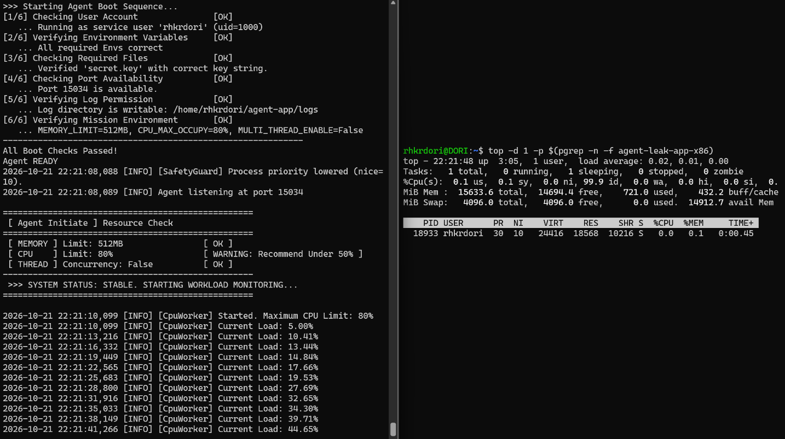
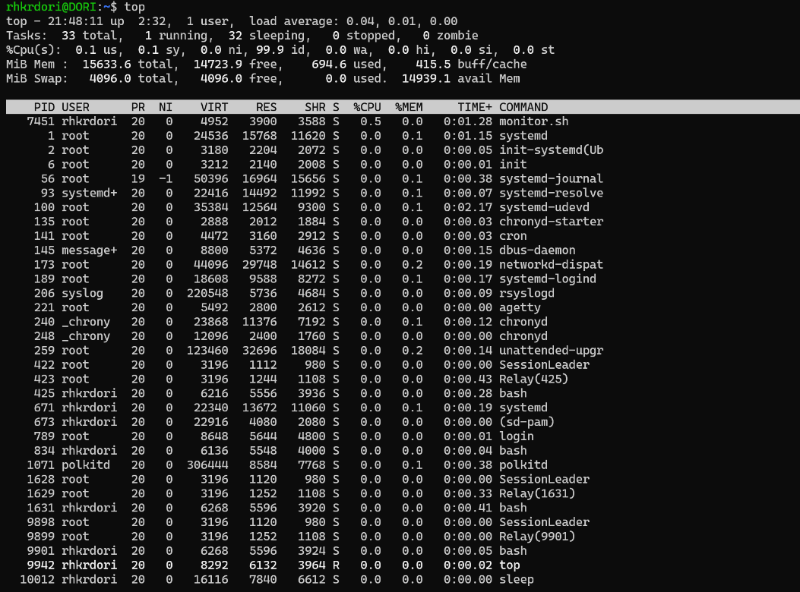
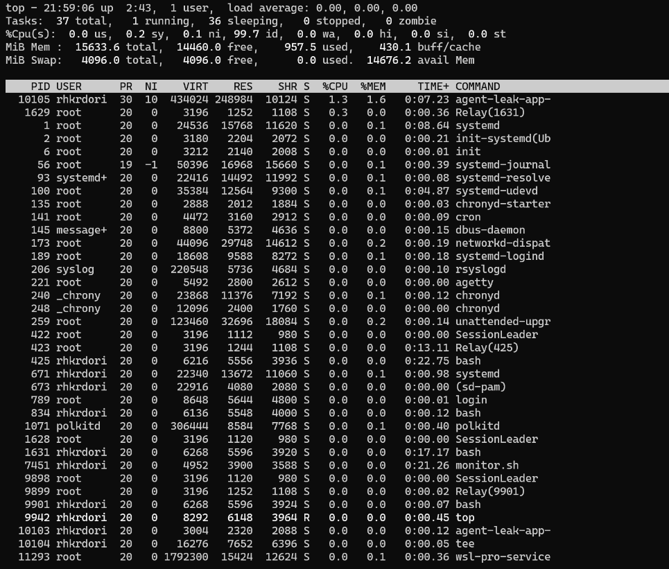
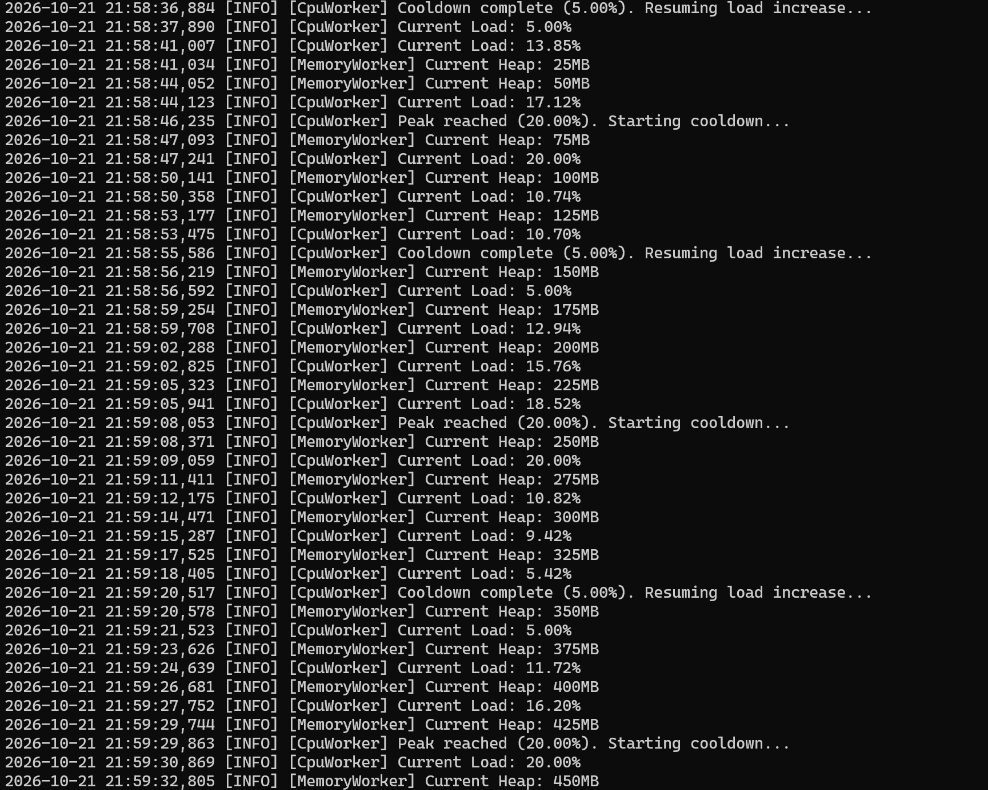
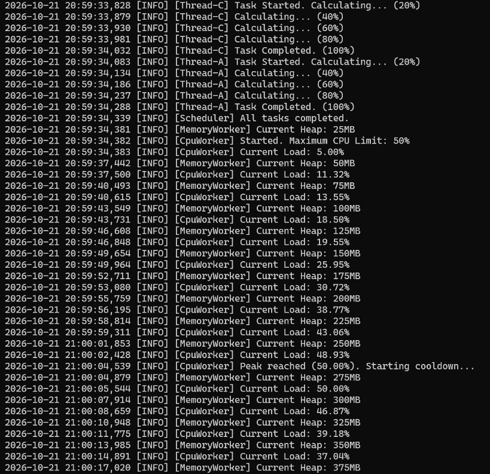

# [Bug] CPU - 부하 50% 초과 시 Watchdog 정책에 의해 SIGTERM 종료

## 1. Description (현상 설명)

- `agent-leak-app`을 `CPU_MAX_OCCUPY=80`으로 실행하면 CpuWorker의 부하가 5%에서 계속 올라가다가 50%를 넘는 순간 `[CRITICAL] [CpuWorker] CPU Threshold Violated!`를 출력하고 종료된다.
- 같은 조건으로 5회 실행(수동 4회 + 자동 1회)해 5회 모두 약 27~52초 뒤 같은 방식으로 종료되었다.
- 종료 코드는 **143**(128 + 15, SIGTERM)으로, 오류에 의한 비정상 종료가 아니라 종료 신호를 받아 끝난 것이다.

**조건 (Before)**: `MEMORY_LIMIT=512`, `CPU_MAX_OCCUPY=80`, `MULTI_THREAD_ENABLE=false`

부트 단계에서 경고가 출력된다.

```
 [ CPU    ] Limit: 80%                  [ WARNING: Recommend Under 50% ]
```

## 2. Evidence & Logs (증거 자료)

### 2-1. 프로그램 실행 로그 (Before, 22:21 실행)

```
2026-10-21 22:21:08,089 [INFO] Agent listening at port 15034
2026-10-21 22:21:10,099 [INFO] [CpuWorker] Started. Maximum CPU Limit: 80%
2026-10-21 22:21:10,099 [INFO] [CpuWorker] Current Load: 5.00%
2026-10-21 22:21:22,565 [INFO] [CpuWorker] Current Load: 17.66%
2026-10-21 22:21:31,916 [INFO] [CpuWorker] Current Load: 32.65%
2026-10-21 22:21:41,266 [INFO] [CpuWorker] Current Load: 44.65%
2026-10-21 22:21:47,498 [INFO] [CpuWorker] Current Load: 48.72%
2026-10-21 22:21:50,614 [INFO] [CpuWorker] Current Load: 58.03%
2026-10-21 22:21:50,715 [CRITICAL] [CpuWorker] CPU Threshold Violated! (58.029999999999994%).
```

### 2-2. 종료 코드 (OS 측 증거)

```
rhkrdori@DORI:~/agent-app$ ./agent-leak-app-x86 2>&1 | tee cpu_80_exit.log
...
[CRITICAL] [CpuWorker] CPU Threshold Violated! (...)
rhkrdori@DORI:~/agent-app$ echo ${PIPESTATUS[0]}
143
```

10/23 자동 재현에서도 `run_case.sh`가 앱의 종료 코드를 직접 기록했다. ([logs/cpu_before/result.env](../logs/cpu_before/result.env))

```
2026-10-23 17:18:47,962 [INFO] [CpuWorker] Current Load: 55.14%
2026-10-23 17:18:48,063 [CRITICAL] [CpuWorker] CPU Threshold Violated! (55.13999999999999%).

RESULT='EXITED'
EXIT_CODE='143'
SIGNAL='SIGTERM'
```

- `| tee`로 실행했기 때문에 `$?`가 아닌 `${PIPESTATUS[0]}`로 앱의 종료 코드를 확인했다.
- 시그널로 종료된 프로세스의 종료 코드는 128 + 시그널 번호다. 143 = 128 + 15 → **SIGTERM**
- 실행 로그와 `logs/agent_app.log` 모두 위반 줄 다음에 별도의 `WATCHDOG… SIGTERM` 문구는 남지 않았다. 따라서 SIGTERM 종료 사실은 종료 코드로 확인했다.

### 2-3. 재현 결과 (Before 5회)

| 실행 시작 (listening) | 위반 시각 | 위반 시 부하 | 생존 시간 |
|---|---|---|---|
| 10/21 22:13:45.675 | 22:14:25.181 | 51.54% | 약 40초 |
| 10/21 22:19:32.925 | 22:19:59.964 | 54.24% | 약 27초 |
| 10/21 22:20:25.017 | 22:20:52.060 | 56.65% | 약 27초 |
| 10/21 22:21:08.089 | 22:21:50.715 | 58.03% | 약 43초 |
| 10/23 17:17:56.107 (자동) | 17:18:48.063 | 55.14% | 약 52초, exit 143 |

5회 모두 설정값 80%가 아니라 **부하가 처음 50%를 넘은 측정**에서 위반 판정이 났다.

### 2-4. OS 측정 결과 (monitor.sh, top)

**monitor.sh (22:13 실행, PID 17241)**

```
[2026-10-21 22:13:43] PROCESS:agent-leak-app STATUS:NOT_RUNNING
[2026-10-21 22:13:45] PROCESS:agent-leak-app PID:17241 CPU:0.0% MEM:0.1% RSS:18.1MB THREADS:1 STAT:SN+ DISK_FREE:955G
[2026-10-21 22:13:59] PROCESS:agent-leak-app PID:17241 CPU:4.0% MEM:0.1% RSS:18.2MB THREADS:1 STAT:SN+ DISK_FREE:955G
[2026-10-21 22:14:21] PROCESS:agent-leak-app PID:17241 CPU:0.0% MEM:0.1% RSS:18.2MB THREADS:1 STAT:SN+ DISK_FREE:955G
[2026-10-21 22:14:24] PROCESS:agent-leak-app PID:17241 CPU:0.0% MEM:0.1% RSS:MB THREADS: STAT: DISK_FREE:955G
[2026-10-21 22:14:27] PROCESS:agent-leak-app STATUS:NOT_RUNNING
```

- 22:14:24 줄의 RSS·STAT이 비어 있는 것은 측정 도중 프로세스가 종료되었기 때문이다. 앱 로그의 위반 시각(22:14:25)과 일치한다.
- 10/23 자동 재현의 monitor.sh 측정에서도 CPU는 최대 2.4%였다. ([logs/cpu_before/monitor.log](../logs/cpu_before/monitor.log))

**top (22:21 실행, 앱 로그 Current Load 48.72% 시점)**

```
top - 22:21:48 up  3:05,  1 user,  load average: 0.02, 0.01, 0.00
%Cpu(s):  0.1 us,  0.1 sy,  0.0 ni, 99.9 id, ...
    PID USER      PR  NI    VIRT    RES    SHR S  %CPU  %MEM     TIME+
  18933 rhkrdori  30  10   24416  18568  10216 S   0.0   0.1   0:00.45
```



- 사용 명령: `top -d 1 -p <PID>` (`-d 1`: 1초마다 갱신, `-p`: 해당 PID만 표시)
- `TIME+ 0:00.45`: 시작 후 약 40초 동안 이 프로세스가 실제로 사용한 CPU 시간 합계가 0.45초 (평균 약 1%)
- `99.9 id`: 시스템 전체 CPU도 대부분 유휴 상태
- `NI 10`: 앱 로그의 `Process priority lowered (nice=10)`가 OS에서도 확인됨

**시스템 전체 top: 앱 실행 전 기준선 vs 실행 중**





- 실행 중에도 agent-leak-app의 %CPU는 1.3%이고 시스템은 99.7% idle → OS 수준의 CPU 급상승은 없음

## 3. Root Cause Analysis (원인 분석)

### 설정값과 실제 판정 기준의 차이

설정값(`CPU_MAX_OCCUPY=80`)과 실제 종료 시점(부하 51~58%)이 다르다. 로그를 보면 두 기준이 따로 동작하는 것으로 보인다.

1. `CPU_MAX_OCCUPY`는 CpuWorker가 부하를 올리는 상한이다. 50으로 설정하면 `Peak reached (50.00%). Starting cooldown`이 출력되고, 그 지점에서 부하를 낮춘다. 20으로 설정하면 `Peak reached (20.00%)`에서 cooldown이 반복된다.
2. Watchdog은 설정값과 상관없이 50%를 기준으로 위반을 판정한다. 80으로 설정한 5번의 실행 모두 부하가 처음 50%를 넘은 측정(51~58%)에서 `Threshold Violated`가 발생했다.



따라서 설정값이 50을 넘으면, 부하가 상한에 닿기 전에 Watchdog 기준을 먼저 넘어 종료된다. 부팅 시 출력되는 `Recommend Under 50%` 경고도 이 기준과 일치한다. 이는 소스 코드가 아니라 관측된 로그 패턴에 근거한 추론이다.

### 종료 원인: Watchdog 과점유 방지 정책

- 오류 스택이나 예외 로그 없이, 위반 판정 직후 SIGTERM(종료 코드 143)으로 끝났으므로 **버그로 인한 크래시가 아니라 보호 정책에 의한 의도된 종료**다.

### 관측 한계: 앱 지표와 OS 측정값의 차이

- 앱 로그의 `Current Load`는 50% 이상까지 올랐지만, 같은 구간 OS 측정값(top, monitor.sh)은 0~4%였고 누적 CPU 시간도 0.45초였다.
- 따라서 이 앱의 `Current Load`는 실제 CPU 사용률이 아니라 **장애 상황을 재현하기 위한 앱 내부 지표**로 보이며, Watchdog도 이 내부 지표를 기준으로 판단한 것으로 추정한다.
- 이번 실험에서는 OS 수준의 CPU 급상승은 관측되지 않았다. 실제 과점유였다면 top에서 해당 프로세스의 `%CPU`와 `TIME+`가 급증하고, 시스템 `id` 값이 떨어졌을 것이다.

### 관련 OS 동작 원리

- CPU는 여러 프로세스가 스케줄러를 통해 시간을 나눠 쓰는 자원이다. 한 프로세스가 CPU를 독점하면 다른 프로세스가 실행 차례를 늦게 받아 시스템 전체의 응답이 지연된다.
- Watchdog은 원인 프로세스 하나를 종료해 나머지 서비스를 보호한다. 즉시 강제 종료하는 SIGKILL(9)이 아니라 SIGTERM(15)을 보내 프로세스가 정리 작업을 할 기회를 준다.

## 4. Workaround & Verification (조치 및 검증)

**조치**: `env.sh`의 `CPU_MAX_OCCUPY`를 80 → 50으로 변경 (다른 값은 동일)

```bash
export CPU_MAX_OCCUPY=50   # 80 -> 50
source ~/agent-app/env.sh
```

부트 단계 경고가 사라졌다.

```
 [ CPU    ] Limit: 50%                  [ OK ]
```

**After: 프로그램 실행 로그** (`logs/agent_app.log`, 20:59 실행)

```
2026-10-21 20:59:34,382 [INFO] [CpuWorker] Started. Maximum CPU Limit: 50%
2026-10-21 20:59:34,383 [INFO] [CpuWorker] Current Load: 5.00%
2026-10-21 21:00:02,428 [INFO] [CpuWorker] Current Load: 48.93%
2026-10-21 21:00:04,539 [INFO] [CpuWorker] Peak reached (50.00%). Starting cooldown...
2026-10-21 21:00:08,659 [INFO] [CpuWorker] Current Load: 46.87%
2026-10-21 21:00:21,141 [INFO] [CpuWorker] Current Load: 35.64%
2026-10-21 21:00:33,603 [INFO] [CpuWorker] Current Load: 16.53%
```



- 한도에 도달하자 위반 판정 대신 스스로 부하를 낮추는 cooldown이 동작했다.
- 같은 조건의 21:27 실행(PID 5685)은 monitor.sh 기준 1분 42초 이상 종료 없이 실행되었다.
- 10/23 자동 재현에서는 120초 관찰 동안 `Peak reached (50.00%)` → `Cooldown complete (5.00%)` → `Peak reached (50.00%)`가 반복되며 종료되지 않았다. ([logs/cpu_after](../logs/cpu_after))

**Before & After 비교**

| 항목 | Before (80%) | After (50%) |
|---|---|---|
| 부트 검사 | WARNING: Recommend Under 50% | OK |
| 부하 변화 | 5% → 51~58%까지 계속 상승 | 5% → 50%에서 cooldown, 이후 감소 |
| 결과 | Threshold Violated → SIGTERM 종료 (exit 143) | 종료 없음 |
| 생존 시간 | 약 27~52초 (5회) | 수동: 1분 42초 이상 / 자동: 120초 관찰 동안 종료 없음 |

**결론 및 추가 제안**

- 한도를 권장값(50%) 이하로 설정하자 앱이 부하를 한도 안에서 조절해 Watchdog 종료가 발생하지 않았다.
- 다만 이는 부하 상한을 낮춘 임시 조치다.
- 근본 해결 제안
  - 연산 루프에 yield/sleep 삽입: 쉬지 않고 도는 반복문 중간에 잠깐 쉬게 해서 CPU를 다른 프로세스에 양보
  - 작업 분할: 큰 작업을 잘게 나눠 처리해, 한 번에 CPU를 오래 붙잡지 않게 함
  - nice/cgroup(cpu.max)로 CPU 상한 설정: nice는 우선순위를 낮춰 양보하게 하고, cgroup은 OS가 CPU 사용량 상한을 강제로 제한
  - 알고리즘 복잡도 개선: 같은 결과를 더 적은 계산으로 내도록 바꿔 CPU 사용량 자체를 줄임
- 운영 환경에서는 앱 자체 지표만 믿지 말고 OS 측정값(`top`의 `%CPU`, `TIME+`)과 교차 확인해야 한다.
