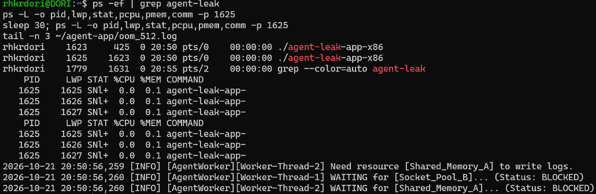
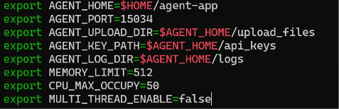
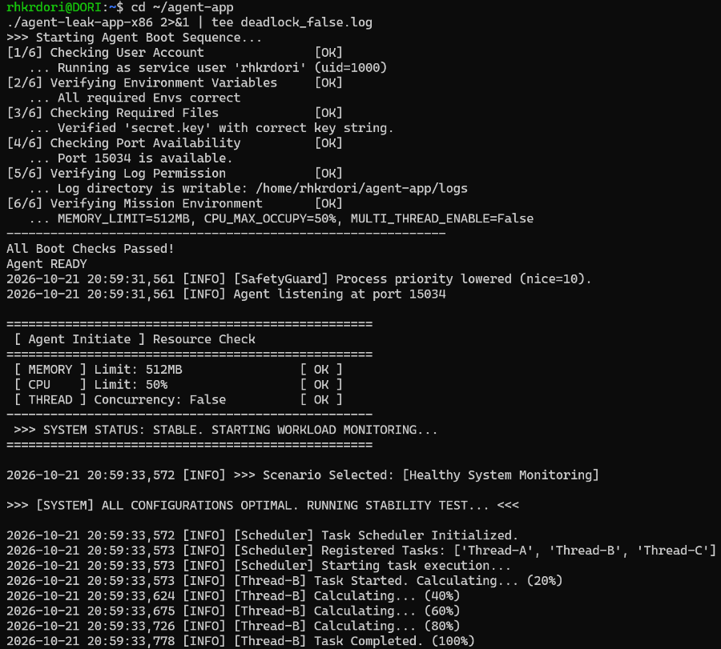

# [Bug] Deadlock - 멀티스레드 모드에서 두 워커 스레드의 순환 대기로 프로세스 무응답

## 1. Description (현상 설명)

- `agent-leak-app`을 `MULTI_THREAD_ENABLE=true`로 실행하면 약 9초 뒤 로그 출력이 완전히 멈춘다.
- 프로세스는 종료되지 않고 PID가 유지되지만, CPU 0.0%·메모리 0.1%로 변화가 없는 무응답 상태가 지속된다.
- 마지막 로그(20:50:56) 이후 확인 시점(20:55)까지 약 4분 이상 새 로그가 없었다. 10/23 자동 재현에서도 같은 지점에서 멈췄다.

**조건 (Before)**: `MEMORY_LIMIT=512`, `CPU_MAX_OCCUPY=50`, `MULTI_THREAD_ENABLE=true`

부트 단계에서 경고가 출력된다.

```
 [ THREAD ] Concurrency: True           [ WARNING ]
 >>> SYSTEM WARNING: POTENTIAL DEADLOCK IN CONCURRENT MODE.
```

## 2. Evidence & Logs (증거 자료)

### 2-1. 프로그램 실행 로그 (마지막 기록 지점)

```
2026-10-21 20:50:49,218 [WARNING] [AgentWorker] Initializing concurrent transaction processors...
2026-10-21 20:50:49,219 [WARNING] [System] CAUTION: Strict resource locking is enabled.
2026-10-21 20:50:54,245 [INFO] [Worker-Thread-1] Process Started. Attempting to lock [Shared_Memory_A]...
2026-10-21 20:50:54,246 [INFO] [AgentWorker][Worker-Thread-2] Process Started. Attempting to lock [Socket_Pool_B]...
2026-10-21 20:50:54,246 [INFO] [AgentWorker] Waiting for worker threads to complete transactions...
2026-10-21 20:50:54,247 [INFO] [AgentWorker][Worker-Thread-1] LOCK ACQUIRED: [Shared_Memory_A]. (Holding...)
2026-10-21 20:50:54,248 [INFO] [AgentWorker][Worker-Thread-2] LOCK ACQUIRED: [Socket_Pool_B]. (Holding...)
2026-10-21 20:50:54,248 [INFO] [AgentWorker][Worker-Thread-1] Processing critical data in Memory A...
2026-10-21 20:50:54,249 [INFO] [AgentWorker][Worker-Thread-2] Establishing network connections in Pool B...
2026-10-21 20:50:56,259 [INFO] [AgentWorker][Worker-Thread-1] Need resource [Socket_Pool_B] to finish job.
2026-10-21 20:50:56,259 [INFO] [AgentWorker][Worker-Thread-2] Need resource [Shared_Memory_A] to write logs.
2026-10-21 20:50:56,260 [INFO] [AgentWorker][Worker-Thread-1] WAITING for [Socket_Pool_B]... (Status: BLOCKED)
2026-10-21 20:50:56,260 [INFO] [AgentWorker][Worker-Thread-2] WAITING for [Shared_Memory_A]... (Status: BLOCKED)
```

### 2-2. PID 존재 및 스레드 상태 (`ps -ef`, `ps -L`)

```
rhkrdori@DORI:~$ ps -ef | grep agent-leak
rhkrdori    1623     425  0 20:50 pts/0    00:00:00 ./agent-leak-app-x86
rhkrdori    1625    1623  0 20:50 pts/0    00:00:00 ./agent-leak-app-x86
rhkrdori    1779    1631  0 20:55 pts/2    00:00:00 grep --color=auto agent-leak

rhkrdori@DORI:~$ ps -L -o pid,lwp,stat,pcpu,pmem,comm -p 1625
    PID     LWP STAT %CPU %MEM COMMAND
   1625    1625 SNl+  0.0  0.1 agent-leak-app-
   1625    1626 SNl+  0.0  0.1 agent-leak-app-
   1625    1627 SNl+  0.0  0.1 agent-leak-app-

rhkrdori@DORI:~$ sleep 30; ps -L -o pid,lwp,stat,pcpu,pmem,comm -p 1625
    PID     LWP STAT %CPU %MEM COMMAND
   1625    1625 SNl+  0.0  0.1 agent-leak-app-
   1625    1626 SNl+  0.0  0.1 agent-leak-app-
   1625    1627 SNl+  0.0  0.1 agent-leak-app-

rhkrdori@DORI:~$ tail -n 3 ~/agent-app/oom_512.log
2026-10-21 20:50:56,259 [INFO] [AgentWorker][Worker-Thread-2] Need resource [Shared_Memory_A] to write logs.
2026-10-21 20:50:56,260 [INFO] [AgentWorker][Worker-Thread-1] WAITING for [Socket_Pool_B]... (Status: BLOCKED)
2026-10-21 20:50:56,260 [INFO] [AgentWorker][Worker-Thread-2] WAITING for [Shared_Memory_A]... (Status: BLOCKED)
```



**해석**

| 확인 항목 | 결과 | 의미 |
|---|---|---|
| `ps -ef` | PID 1623(부모), 1625(자식) 존재 | 프로세스는 살아 있음 |
| PID 관계 | 1625의 부모가 1623 | 1623은 실행 파일 래퍼(스레드 1개, `S+`로 자식 대기), 실제 앱은 1625 |
| `ps -L` 스레드 | LWP 1625, 1626, 1627 | 메인 스레드 + 워커 스레드 2개로 추정 |
| STAT `SNl+` | S: 잠듦, N: 낮은 우선순위(nice=10), l: 멀티스레드, +: 포그라운드 | 모든 스레드가 무언가를 기다리며 잠든 상태 |
| 30초 전후 비교 | %CPU 0.0, %MEM 0.1 동일 | 연산도 메모리 변화도 없음 |
| `tail` | 마지막 로그 20:50:56에서 정지 | 진행 없음 |

### 2-3. 커널 대기 지점 (10/23 자동 재현, PID 11062)

`run_case.sh`가 로그 정지를 감지한 뒤 스레드별 커널 대기 지점(`wchan`)과 `top -H`를 자동 수집했다. ([logs/deadlock_before/deadlock_evidence.txt](../logs/deadlock_before/deadlock_evidence.txt))

```
### 17:21:36  ps -L -o pid,lwp,stat,%cpu,%mem,rss,wchan:24,comm -p 11062
    PID     LWP STAT %CPU %MEM   RSS WCHAN                    COMMAND
  11062   11062 SNl+  0.1  0.1 18472 futex_do_wait            agent-leak-app-
  11062   11270 SNl+  0.0  0.1 18472 futex_do_wait            agent-leak-app-
  11062   11271 SNl+  0.0  0.1 18472 futex_do_wait            agent-leak-app-

### 17:21:46  top -H -p 11062  (10초 후)
Threads:   3 total,   0 running,   3 sleeping,   0 stopped,   0 zombie
    PID USER      PR  NI    VIRT    RES    SHR S  %CPU  %MEM     TIME+ COMMAND
  11062 rhkrdori  30  10  170868  18472  10224 S   0.0   0.1   0:00.07 agent-l+
  11270 rhkrdori  30  10  170868  18472  10224 S   0.0   0.1   0:00.00 agent-l+
  11271 rhkrdori  30  10  170868  18472  10224 S   0.0   0.1   0:00.00 agent-l+
```

- WCHAN `futex_do_wait`: 세 스레드 모두 커널의 futex(리눅스의 락 구현 기능)에서 락 해제를 기다리며 잠든 상태
- `TIME+`(누적 CPU 시간)가 10초 전과 동일 → 연산하지 않음 (무한루프가 아님)
- 마지막 로그도 10/21과 같은 `WAITING for [Socket_Pool_B]` / `WAITING for [Shared_Memory_A]` 두 줄

### 2-4. monitor.sh 관제 로그 — CPU/MEM 변화 정체 (10/23 자동 재현)

([logs/deadlock_before/monitor.log](../logs/deadlock_before/monitor.log))

```
[2026-10-23 17:21:06] PROCESS:agent-leak-app- PID:11060 STATE:S CPU:0.0% MEM:0.1% RSS:20MB THREADS:4 PROCS:2 DISK:955G FIREWALL:unknown   <- 마지막 BLOCKED 로그 시각
[2026-10-23 17:21:11] PROCESS:agent-leak-app- PID:11060 STATE:S CPU:0.0% MEM:0.1% RSS:20MB THREADS:4 PROCS:2 DISK:955G FIREWALL:unknown
...
[2026-10-23 17:21:42] PROCESS:agent-leak-app- PID:11060 STATE:S CPU:0.0% MEM:0.1% RSS:20MB THREADS:4 PROCS:2 DISK:955G FIREWALL:unknown
[2026-10-23 17:21:51] PROCESS:agent-leak-app- PID:11060 STATE:S CPU:0.0% MEM:0.1% RSS:20MB THREADS:4 PROCS:2 DISK:955G FIREWALL:unknown
[2026-10-23 17:21:53] PROCESS:11060 STATUS:GONE   <- 관찰 종료 후 스크립트가 직접 종료
```

- 마지막 로그(17:21:06) 이후 약 45초 동안 2초 간격 측정 내내 CPU 0.0%, RSS 20MB 고정
- 프로세스(PID 11060)는 계속 존재 → 죽지 않았지만 아무 일도 하지 않는 무응답 상태
- OOM(RSS 증가)이나 CPU 과점유(CPU 상승)와 달리 **수치 자체가 움직이지 않는 것**이 데드락의 관제 패턴

### 2-5. 진단 흐름 정리

1. `ps -ef`로 PID 존재 확인 → 종료된 것이 아님
2. `ps -L`로 스레드 상태 확인 → `R`(실행 중)이 아니라 모두 `S`(대기), CPU 0% → 무한루프가 아님
3. 30초 뒤 재확인 → 상태 변화 없음 → 일시적 대기가 아님
4. `wchan` 확인 → 모든 스레드가 `futex_do_wait` → 락을 기다리는 중
5. `tail`로 로그 마지막 지점 확인 → 두 스레드가 서로의 자원을 기다리는 `BLOCKED`에서 정지

## 3. Root Cause Analysis (원인 분석)

**스레드-락 대기 관계 (로그에서 추출)**

| 스레드 | 보유 중인 락 | 기다리는 락 | 기다리는 락의 보유자 |
|---|---|---|---|
| Worker-Thread-1 | `Shared_Memory_A` (20:50:54.247 획득) | `Socket_Pool_B` | Worker-Thread-2 |
| Worker-Thread-2 | `Socket_Pool_B` (20:50:54.248 획득) | `Shared_Memory_A` | Worker-Thread-1 |

```
Worker-Thread-1 --(Socket_Pool_B 대기)--> Worker-Thread-2
       ^                                        |
       +-------(Shared_Memory_A 대기)-----------+
```

두 스레드가 각자 첫 번째 락을 잡은 뒤 상대가 가진 락을 요청하면서 **A → B → A** 형태의 원이 만들어졌다. 메인 스레드는 `Waiting for worker threads to complete transactions...` 이후 워커 종료를 기다리고 있어 함께 멈춘 것으로 보인다. 모든 스레드의 `wchan`이 `futex_do_wait`인 것은 이 추론을 OS 측에서 뒷받침한다.

**교착상태 4대 조건 검증**

| 조건 | 이 상황에서의 근거 |
|---|---|
| 상호 배제 (Mutual Exclusion) | `Strict resource locking is enabled`: A, B는 한 번에 한 스레드만 보유 |
| 점유 대기 (Hold and Wait) | 각 스레드가 `(Holding...)` 상태로 락을 쥔 채 다른 락을 `WAITING` |
| 비선점 (No Preemption) | 상대가 쥔 락을 빼앗거나 타임아웃으로 포기하는 로그가 없음 |
| 순환 대기 (Circular Wait) | Thread-1 → B(Thread-2 보유), Thread-2 → A(Thread-1 보유) |

네 조건이 동시에 성립하므로 **교착상태(Deadlock)**다. 락을 해제하는 코드는 작업을 마친 뒤에 실행되므로, 어느 스레드도 먼저 락을 놓지 못하고 영원히 대기한다.

식사하는 철학자 문제로 보면, 두 철학자(스레드)가 각자 왼쪽 포크(첫 번째 락)를 든 채 오른쪽 포크(상대가 든 락)를 기다려 아무도 식사를 시작하지 못하는 상황과 같다.

**OOM·CPU 장애와의 차이**

- 무한루프라면 스레드가 `R` 상태로 CPU를 계속 사용했을 것이다. 이 경우 CPU 0%의 `S` 상태이므로 계산 중이 아니라 **대기 중**이다.
- 프로세스가 죽지 않아 "PID 있음 = 정상"으로 오인하기 쉽고, 에러 로그도 남지 않아 OOM·CPU 장애보다 발견이 늦어질 수 있다.

## 4. Workaround & Verification (조치 및 검증)

**조치**: `env.sh`의 `MULTI_THREAD_ENABLE`을 true → false로 변경 (다른 값은 동일)

```bash
export MULTI_THREAD_ENABLE=false   # true -> false
source ~/agent-app/env.sh
```



**After: 프로그램 실행 로그** (`logs/agent_app.log`, 20:59 실행)

```
 [ THREAD ] Concurrency: False          [ OK ]
 >>> SYSTEM STATUS: STABLE. STARTING WORKLOAD MONITORING...

2026-10-21 20:59:33,572 [INFO] >>> Scenario Selected: [Healthy System Monitoring]
2026-10-21 20:59:33,573 [INFO] [Scheduler] Registered Tasks: ['Thread-A', 'Thread-B', 'Thread-C']
2026-10-21 20:59:34,339 [INFO] [Scheduler] All tasks completed.
2026-10-21 20:59:34,381 [INFO] [MemoryWorker] Current Heap: 25MB
2026-10-21 20:59:34,382 [INFO] [CpuWorker] Started. Maximum CPU Limit: 50%
...  (이후 로그 계속 출력)
```



- `Attempting to lock`, `WAITING`, `BLOCKED` 로그가 나타나지 않았고, 작업이 끝까지 진행되었다.
- 같은 조건의 21:13 실행, 21:27 실행(PID 5685, monitor.sh 기준 1분 42초 이상 실행)에서도 데드락은 재현되지 않았다.
- 10/23 자동 재현에서도 120초 관찰 동안 로그가 계속 출력되었다. ([logs/deadlock_after](../logs/deadlock_after))

**Before & After 비교**

| 항목 | Before (true) | After (false) |
|---|---|---|
| 부트 검사 | WARNING: POTENTIAL DEADLOCK | OK, STABLE |
| 락 경쟁 | Thread-1·2가 A·B를 교차 요청 | 락 경쟁 로그 없음 |
| 로그 | 마지막 `BLOCKED` 이후 정지 | 계속 출력 |
| 프로세스 상태 | 살아 있으나 모든 스레드 `S`(futex 대기), CPU 0% | 정상 동작 |

**결론 및 추가 제안**

- 서로 락을 기다릴 상대 워커가 없어지자 점유 대기와 순환 대기가 성립하지 않아 데드락이 회피되었다. 다만 동시 처리를 포기하는 임시 조치라 처리량이 떨어질 수 있다.
- 근본 해결 제안
  - 모든 스레드가 락을 **같은 순서로** 획득(순환 대기 제거): 모두 A → B 순서로만 잠그면 대기가 한 방향으로만 생겨 원이 만들어지지 않음
  - `acquire(timeout=...)` 로 타임아웃 후 재시도(점유 대기 완화): 정해진 시간 안에 두 번째 락을 못 얻으면 쥔 락을 내려놓고 잠시 후 다시 시도
  - 락 범위 최소화 또는 큐 기반 설계로 공유 자원 제거: 락을 쥐는 구간을 줄이거나, 자원 담당 스레드 하나에 큐로 요청만 넘겨 락 경쟁 자체를 없앰
- 운영 관제 개선: 로그 파일이 일정 시간 갱신되지 않거나 모든 스레드가 장시간 `S` 상태이면 경고하는 heartbeat 감시를 monitor.sh에 추가
